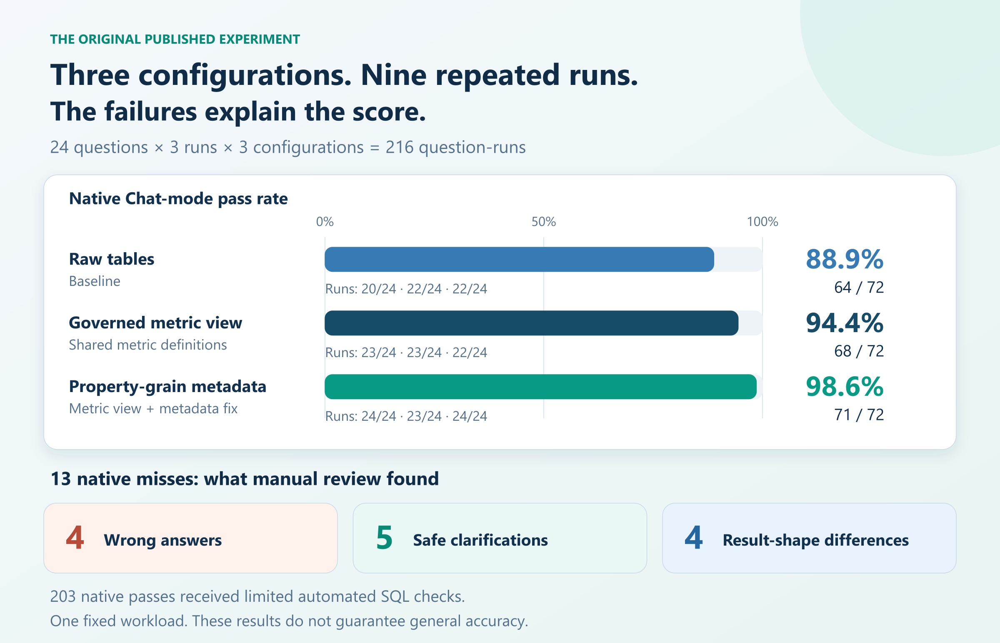

# Genie Truth Lab

A hands-on Databricks Genie experiment: test a fixed workload, add a governed metric view, and inspect what the score misses.

[Read the article](https://medium.com/@mkhomutskyi/i-graded-216-databricks-genie-answers-the-score-missed-the-best-part-8c2609d16f5a) · [Try it](docs/SETUP.md) · [Read the results](RESULTS.md)



## What you will build

Three configurations over the built-in simulated `samples.wanderbricks` dataset:

1. **Raw tables:** bookings and properties.
2. **Governed metric view:** shared measures, centered on Gross Booked Value.
3. **Property-grain metadata:** require a unique Property ID and treat the title as a display label.

The same 24 questions run three times per configuration. Twelve prompts support development; twelve are reserved paraphrases of known intents. The workload, checked SQL, and configurations are included so you can run your own experiment.

## Try it in Free Edition

Follow the [setup guide](docs/SETUP.md). No proprietary data or data download is needed. Use an existing SQL warehouse and a writable sandbox schema. Free Edition is for non-commercial learning and is quota-limited; feature availability and results can vary.

Without a native benchmark screen, you can compare fresh conversations with the checked SQL manually. That fallback does not reproduce the native score.

## Published results

| Configuration | Native passes | Pass rate |
|---|---:|---:|
| Raw tables | 64 / 72 | 88.9% |
| Governed metric view | 68 / 72 | 94.4% |
| Property-grain metadata | 71 / 72 | 98.6% |

The original experiment contained nine Chat-mode runs and 216 question-runs in an existing sandbox. Manual review of its 13 native misses found four wrong answers, five safe clarifications, and four result-shape differences. The other 203 native passes received limited automated SQL checks. These descriptive results are not a general accuracy guarantee; a new run may differ.

[RESULTS.md](RESULTS.md) explains the method and limits.

## Project guide

| Folder | Purpose |
|---|---|
| `agents/` | Baseline, metric-view, and property-grain configurations |
| `benchmarks/` | The 24 fixed prompts and checked SQL answers |
| `config/` | Metric definitions and experiment boundaries |
| `deploy/` | Parameterized metric-view SQL |
| `docs/` | Setup and evaluation instructions |
| `assets/` | Finished article diagrams and editable originals |
| `scripts/` | Setup, run export, manual-review templates, and scoring |
| `sql/` | Read-only source inspection and checked answers |
| `tests/` | Workload, configuration, and scoring checks |

Your own run exports and workspace state go under `local/`, which is ignored by Git.

## Development

Python 3.11 or later, with [uv](https://docs.astral.sh/uv/):

```bash
uv sync --frozen --dev
uv run python scripts/build_agent_configs.py
uv run python scripts/check_workload.py
uv run pytest -q
```

All source data is simulated. Licensed under [Apache 2.0](LICENSE).
