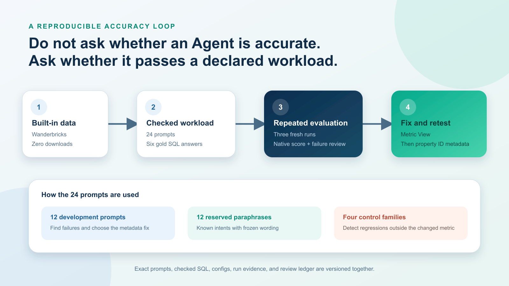

# Results and method

These are the original results reported in [the article](https://medium.com/@mkhomutskyi/i-graded-216-databricks-genie-answers-the-score-missed-the-best-part-8c2609d16f5a), collected in October 2026 in an existing Databricks sandbox. They describe one fixed workload, not universal Genie accuracy.

## Workload

Six intent families with four phrasings each: 24 prompts. Each family has two development prompts and two reserved paraphrases. Separately, four control families account for 16 prompts and two Gross Booked Value families account for eight. These are overlapping labels for the same 24 prompts.

All three configurations used the same prompts and checked SQL. Each configuration ran three times in Chat mode, for 72 question-runs per configuration and 216 in total. The checked workload is in [benchmarks/manifest.json](benchmarks/manifest.json).

## Native results

| Configuration | Run 1 | Run 2 | Run 3 | Total | Pass rate |
|---|---:|---:|---:|---:|---:|
| Raw tables | 20/24 | 22/24 | 22/24 | 64/72 | 88.9% |
| Governed metric view | 23/24 | 23/24 | 22/24 | 68/72 | 94.4% |
| Property-grain metadata | 24/24 | 23/24 | 24/24 | 71/72 | 98.6% |

The first treatment replaced two raw tables with one metric view governing four measures. A development failure then revealed grouping by non-unique Property Title. The final configuration requires Property ID as the grain, treats the title as a display label, and moves the `listing` synonym to ID. Formulas and reserved wording remained unchanged.

## What the misses revealed

All 13 native misses were manually reviewed:

| Finding | Count |
|---|---:|
| Wrong business answer | 4 |
| Safe clarification that did not complete the request | 5 |
| Correct business values with a different result shape | 4 |

The other 203 native passes received limited automated checks for successful SQL execution, expected metric-view naming, and selected prohibited terms. Those checks did not review every table reference or every narrative statement. A native pass is not a substitute for business review.

## Limits

- The 72 question-runs per condition repeat 24 prompts; they are not 72 independent questions.
- The first treatment changed the source surface and four governed measures, so the change cannot be attributed to one description alone.
- The metadata optimization was selected after a development failure. Reserved prompts test wording on known intents, not generalization to unseen business problems.
- The original nine-run benchmark ran in an existing sandbox. A separate fresh Free Edition check completed one governed 24-prompt run; it was not the source of these historical scores.
- Product updates, data snapshots, quota availability, and generated answers can change a rerun. No causal or statistical-significance claim is made.

To evaluate your own workspace, follow [the setup guide](docs/SETUP.md), retain your outputs locally, and review failures against the declared metric definitions and checked SQL.
